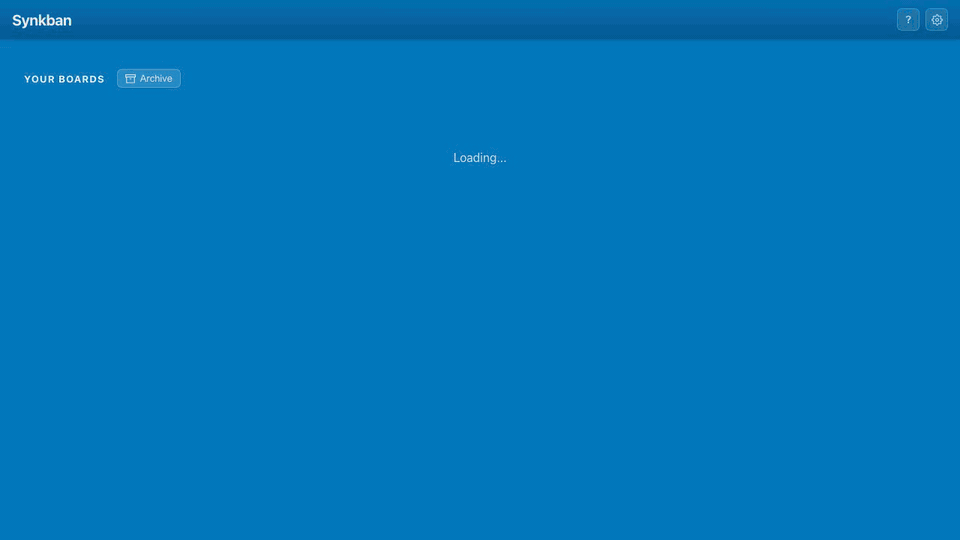

# Synkban

**Kanban boards and notes — stored as plain files you own. Fast and keyboard friendly.**

Organise tasks across lists in **Kanban Mode**, switch any board to **Notes Mode** for long-form writing, and sync seamlessly with Syncthing, Dropbox, iCloud, Nextcloud, or Git. Available as a native **Desktop App** (macOS, Windows, Linux) or self-hosted **Web Mode** / mobile PWA — no cloud account, no database lock-in.

➡️ **[Website](https://waschmittel.github.io/Synkban/)** · **[Download Desktop App](https://github.com/waschmittel/Synkban/releases/latest)** · **[User Guide](docs/user-guide.md)** · **[Technical & Self-Hosting Reference](docs/technical-reference.md)**



## Why Synkban?

- **Plain files, zero lock-in** — Every board, list, and card is readable JSON on disk (with sidecar attachment files). Copy, back up, or inspect your workspace anytime.
- **Conflict-friendly sync** — One JSON file per card means edits on different cards never clash in Syncthing, Dropbox, iCloud, or Git. External file changes refresh every 15 seconds.
- **Kanban Mode & Notes Mode on one board** — Track pipelines side by side, or press `V` to turn any board into **List Tabs** with an inline **Notes Pane** for focused writing.
- **Crash-safe & built to last** — Deliberate `Cmd/Ctrl + S` saves keep sync clean while machine-local **Draft** recovery protects unsaved typing. Two-step **Archive**, 100-version **Card History**, and offline **PDF/A-2u** export safeguard your work.

## What You Can Do

- **Board Overview & Board Dock** — Start on **Your Boards** with custom colours (auto-tuned light/dark palette), total card and overdue counts, and relative last-edited times. Rename boards inline, reorder them, or switch boards quickly from the bottom **Board Dock** (`,`, `.`, `J`, `K`) with per-session view memory.
- **Kanban Mode & Collapsed Lists** — Navigate lists with sticky-row arrow keys, collapse quieter lists like *Done* into narrow vertical strips (`C`) that still accept drops, and move cards by mouse drag, keyboard (`Shift + ← / →`), or long-press touch.
- **Notes Mode (`V`)** — Dedicated split master-detail workspace where each board saves its preferred view mode across synced devices.
- **Quick-add (`#label` & `due:`)** — Assign labels and due dates (`#design`, `due:fri`, `due:tomorrow`, `due:+3d`, `due:2026-12-01`) directly in a new card's title with live preview chips.
- **Rich Card Detail** — Bold/italic titles (`**bold**`, `*italic*`), structured rich-text **Description** via the **`Cmd/Ctrl + K` Editor Menu** (Heading 1–3, code blocks, quotes, nested lists, smart links, tables, transposable 2D **Matrices**, and inline pasted/embedded images), keyboard-first **Due Date Picker** (`Cmd/Ctrl + U`), flat **Checklists** (`Cmd/Ctrl + L`), and file **Attachments** (≤50 MB) with thumbnails and preview lightbox.
- **Ordered Labels & Filter Bar** — Manage and reorder board **Labels** in the **Label Drawer** (`G`, with safe **Label Merge** on rename), and narrow any board via the **Filter Bar** (`F`) combining text, due-date range (*Overdue*, *This week*, *Until…*), and labels.
- **History, PDF/A Export & Safety** — Compare the last 100 saved versions field-by-field (`Cmd/Ctrl + J`), export saved cards offline to archival **PDF/A-2u** (`Cmd/Ctrl + P`), recover items from the **Archive Panel** (`A`), choose System / Light / Dark mode in **Settings**, and press **`?`** anywhere for contextual shortcut help.

## Install the Desktop App

Download prebuilt installers for **macOS**, **Windows**, and **Linux** from the **[latest GitHub Release](https://github.com/waschmittel/Synkban/releases/latest)**:

- **macOS (Apple Silicon):** Open the `.dmg` (or `.zip`) and drag **Synkban.app** into **Applications**. Because release builds are currently unsigned, macOS Gatekeeper may warn on first launch — run once in Terminal:
  ```bash
  sudo xattr -cr /Applications/Synkban.app
  ```
- **Windows:** Run the `.exe` installer.
- **Linux:** Launch the portable `.AppImage` or install the `.deb` package.

To sync across devices, open **⚙ Settings → Data folder → Browse…** and point Synkban at any folder inside Syncthing, Dropbox, iCloud Drive, Nextcloud, or Git. For a complete everyday walkthrough, see the **[User Guide](docs/user-guide.md)**.

---

## Self-Hosting, CLI & Developers

Everything below is only needed for headless servers, Docker / mobile PWA setups, raw configuration files, or building from source.

### Web Mode & Docker / PWA

Synkban also runs as a single self-contained web server binary (or multi-arch Docker container) installable as a **Progressive Web App (PWA)** on iOS, Android, and desktop:

```bash
# Run the standalone web server (HTTP on localhost:8080 by default)
HOST=0.0.0.0 PORT=8080 ./synkban

# Or pull the multi-arch container image
docker pull ghcr.io/waschmittel/synkban:latest
```

> **Security note:** Web Mode has **no built-in authentication** (single-user design). Bind to `127.0.0.1`, run over a private network such as Tailscale, or place it behind an authenticating reverse proxy (see the Traefik + Tinyauth PWA setup guide).

Full CLI flags (`--data-dir`), environment variables (`HOST`, `PORT`, `DATA_DIR`, `SYNKBAN_CONFIG_DIR`), `synkban.toml`, and the on-disk JSON storage layout live in the **[Technical & Self-Hosting Reference](docs/technical-reference.md)**.

### Build from Source

Synkban compiles a SolidJS frontend embedded directly into a Rust (Actix Web) binary, with an optional Electron desktop shell:

```bash
./build.sh            # builds frontend, Rust release binary, and runs Playwright e2e
./build.sh --desktop  # packages the Electron Desktop App into electron/dist/
```

### Documentation

**For Users**

- **[Website & Showcase](https://waschmittel.github.io/Synkban/)** — Feature overview, interactive previews, and Desktop App downloads
- **[User Guide](docs/user-guide.md)** — Everyday walkthrough for Kanban & Notes modes, Quick-add, rich editing, filters, PDF export, and syncing

**For Self-Hosters & Developers**

- **[Technical & Self-Hosting Reference](docs/technical-reference.md)** — Web Mode CLI flags, environment variables, Docker/PWA overview, `synkban.toml`, and storage internals
- **[Docker + Traefik + Tinyauth PWA Guide](docs/docker/README.md)** — Docker Compose setup with persistent single-prompt login and mobile PWA support
- **[PDF Export Examples](docs/export-examples/README.md)** — Generated PDF/A-2u reference samples
- **[Development Guide](docs/development.md)** — Dev workflow, REST API reference, architecture notes, and testing
- **[Architecture Decision Records](docs/adr/)** & **[Ubiquitous Language](UBIQUITOUS_LANGUAGE.md)** — Design decisions and domain glossary

## License

Synkban is released under the [MIT License](LICENSE). Bundled fonts and third-party components keep their own licenses — see [THIRD-PARTY-NOTICES.md](THIRD-PARTY-NOTICES.md).
