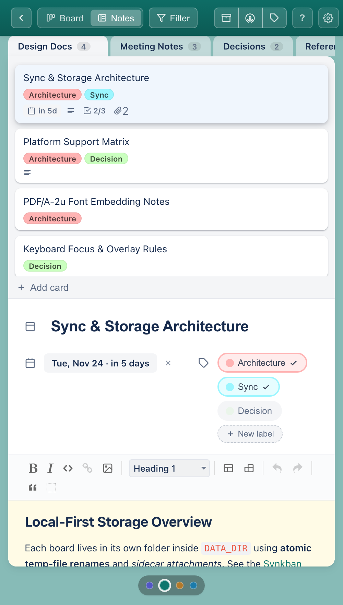

# Synkban Technical & Self-Hosting Reference

This document covers the technical details that everyday **Desktop Mode** users do not need: running Synkban as a standalone web server (**Web Mode**), self-hosting with Docker and installing as a Progressive Web App (PWA), CLI flags and environment variables, `synkban.toml`, on-disk folder structure, and sync internals.

> **Looking for the everyday User Guide?** See **[User Guide](user-guide.md)** for installing the Desktop App, using Kanban & Notes modes, keyboard shortcuts, and daily workflows.

## Table of Contents

- [Standalone Web Server (Web Mode)](#standalone-web-server-web-mode)
- [Self-Hosting with Docker & Installing as a PWA](#self-hosting-with-docker--installing-as-a-pwa)
- [Data Directory, Config Directory & `synkban.toml`](#data-directory-config-directory--synkbantoml)
- [Sync & Storage Internals](#sync--storage-internals)
- [Building from Source & Developer Documentation](#building-from-source--developer-documentation)

---

## Standalone Web Server (Web Mode)

Synkban compiles into a single self-contained binary with all web assets embedded. Run it directly from a terminal (or build it yourself with `./build.sh`):

```bash
./synkban
```

Then open **`http://localhost:8080`** in your browser.

> **Security note:** Web Mode has **no built-in authentication** (single-user design). Run it locally, over a private network (such as Tailscale), or behind an authenticating reverse proxy.

### Command-Line Options & Environment Variables

| Option / Variable | Default | Description |
| --- | --- | --- |
| `--data-dir <path>` | *(see below)* | Path to the **Data Directory** (also accepts `--data-dir=<path>`). Takes precedence over `DATA_DIR` and config file. |
| `-h`, `--help` | — | Print CLI usage help and exit. |
| `-V`, `--version` | — | Print the Synkban version and exit. |
| `DATA_DIR` | *(see below)* | Path to the **Data Directory** (created automatically if absent). |
| `HOST` | `127.0.0.1` | Bind address (`0.0.0.0` in the official Docker image). |
| `PORT` | `8080` | Bind port. |
| `SYNKBAN_CONFIG_DIR` | `~/.config/synkban` | Directory for machine-local settings (`synkban.toml`) and crash drafts (`draft.json`). Uses `%USERPROFILE%\.config\synkban` on Windows; `/app/config` in Docker. |

Example running on a custom port and folder:

```bash
HOST=0.0.0.0 PORT=3000 DATA_DIR=/home/me/Sync/synkban ./synkban
```

---

## Self-Hosting with Docker & Installing as a PWA

Official multi-architecture (`linux/amd64`, `linux/arm64`) container images are published to `ghcr.io/waschmittel/synkban`.

For local or private-network (e.g. Tailscale) use:

```sh
docker run -d \
  --name synkban \
  -p 127.0.0.1:8080:8080 \
  -e DATA_DIR=/data \
  -v /path/on/host/data:/data \
  -v /path/on/host/config:/app/config \
  ghcr.io/waschmittel/synkban:latest
```

> **Important:** The container runs as non-root user `app` (UID `10001`). Ensure host-mounted data and config directories are writable by UID `10001` (for example, `chown -R 10001:10001 /path/on/host/data /path/on/host/config`).

To expose Synkban over HTTPS with persistent single-prompt login and install it as a standalone **Progressive Web App (PWA)** on desktop browsers, Android, or iOS/iPadOS, follow the **[Self-Hosting & Docker Guide (Traefik + Tinyauth PWA)](docker/README.md)**.



---

## Data Directory, Config Directory & `synkban.toml`

Synkban separates **synced workspace data** from **machine-local configuration**:

### 1. Data Directory (Sync This Across Devices)

Holds all boards, lists, cards, archived cards, and attachments under `boards/`:

```text
<DATA_DIR>/
└── boards/
    └── {board-id}/
        ├── board.json
        ├── lists/{list-id}/
        │   ├── list.json
        │   └── cards/{card-id}.json
        ├── archived_cards/{card-id}.json
        └── attachments/{card-id}/
            ├── {att-id}
            ├── {att-id}_thumb
            └── {att-id}.json
```

**Data Directory resolution order** (highest priority wins):
1. `--data-dir <path>` CLI flag
2. `DATA_DIR` environment variable
3. `data_dir` in `~/.config/synkban/synkban.toml`
4. Default: `~/.config/synkban/data/` (`%USERPROFILE%\.config\synkban\data\` on Windows)

### 2. Config Directory (Keep Local to Each Machine)

Default `~/.config/synkban/` (`%USERPROFILE%\.config\synkban\` on Windows, overridable via `SYNKBAN_CONFIG_DIR`). Contains:

- **`synkban.toml`** — machine **Settings** written automatically by the in-app **Settings** dialog (editable directly when Synkban is stopped):

```toml
data_dir = "/home/me/Sync/synkban"
startup_view = "last"      # "overview" (default) | "last"
theme = "system"           # "system" (default) | "light" | "dark"
last_board_id = "..."      # maintained automatically
```

- **`draft.json`** — the machine's local crash-recovery **Draft** for the currently open card (never synced to other devices).

---

## Sync & Storage Internals

- **Atomic file writes:** JSON updates write to a temporary file alongside the target and atomically rename over it, preventing half-written JSON during crashes or sync scans.
- **Sidecar attachment storage:** Each uploaded file stores raw bytes (`{att-id}`), an optional JPEG thumbnail (`{att-id}_thumb` ≤ 400 px for images), and a metadata sidecar (`{att-id}.json`) separately from card JSON so attachment uploads never conflict with card edits.
- **15-second change polling:** The UI polls `GET /api/changes` (newest file modification timestamp per board) every 15 seconds and refreshes open views automatically while preserving focus and open inputs.
- **5-minute startup cleanup grace window:** At startup, partial or orphaned attachment leftovers are cleaned up only when older than 5 minutes so in-flight file transfers from sync tools are never mistaken for garbage.
- **Corrupt / partial file resilience:** Unreadable JSON files are skipped on read, left untouched on disk, and surfaced in a dismissible warning banner naming the exact file path.
- **Network outage handling (Web / PWA Mode):** Already-loaded boards and open card edits remain intact if the server restarts or disconnects, failed quick-adds preserve typed text, and connectivity recovers automatically.
- **Keep versions aligned:** When multiple devices sync the same Data Directory, keep all installations on the same Synkban version so newer rich-text features (such as tables, matrices, or inline images) render consistently everywhere.

---

## Building from Source & Developer Documentation

- **Build single binary:** `./build.sh` (outputs `backend/target/release/synkban`)
- **Build Desktop App:** `./build.sh --desktop` (outputs installers/bundles in `electron/dist/`)
- **[Development Guide](development.md)** — local hot-reload workflow, HTTP API reference, project structure, and test suites
- **[PDF Export Examples](export-examples/README.md)** — reference PDFs demonstrating typography, pagination, tables, matrices, and edge cases
- **[Architecture Decision Records (`docs/adr/`)](adr/0001-json-files-no-database.md)** — design decisions and rationale across the codebase
