# Synkban User Guide

Synkban is a **local-first, keyboard-driven kanban board and structured note-taking workspace** whose data lives as plain JSON files and standalone attachment files on your disk. There is no database, no cloud account, and no vendor lock-in — you own your boards completely and can sync them with whatever tool you already trust.

> **Shortcut notation:** Throughout this guide, **`Cmd/Ctrl`** means **`Cmd` (`⌘`) on macOS** and **`Ctrl` on Windows and Linux**. Press **`?`** anywhere outside a text field to open the contextual in-app shortcut reference.

## Table of Contents

- [Why Synkban?](#why-synkban)
  - [Core Advantages](#core-advantages)
  - [Intentional Scope](#intentional-scope)
- [Getting Started](#getting-started)
  - [Installing the Desktop App](#installing-the-desktop-app)
  - [Two-Minute Walkthrough](#two-minute-walkthrough)
- [Core Concepts](#core-concepts)
- [Managing Boards](#managing-boards)
  - [Board Overview](#board-overview)
  - [Board Top Bar & Personalisation](#board-top-bar--personalisation)
  - [Switching Boards & Session Memory](#switching-boards--session-memory)
- [Kanban Mode & Notes Mode](#kanban-mode--notes-mode)
  - [Kanban Mode](#kanban-mode)
  - [Notes Mode](#notes-mode)
- [Lists & Cards](#lists--cards)
  - [Working with Lists](#working-with-lists)
  - [Adding Cards & Quick-Add Syntax](#adding-cards--quick-add-syntax)
  - [Title Formatting](#title-formatting)
  - [Moving & Reordering (Mouse, Keyboard & Touch)](#moving--reordering-mouse-keyboard--touch)
- [Working Inside a Card](#working-inside-a-card)
  - [Deliberate Saves & Unsaved Changes Guard](#deliberate-saves--unsaved-changes-guard)
  - [Rich-Text Description Editor](#rich-text-description-editor)
  - [Tables & Matrices](#tables--matrices)
  - [Inline Images](#inline-images)
  - [Labels & Label Drawer](#labels--label-drawer)
  - [Due Dates & Keyboard-First Picker](#due-dates--keyboard-first-picker)
  - [Checklist](#checklist)
  - [Attachments](#attachments)
  - [Card History & Diffs](#card-history--diffs)
  - [Archival PDF/A Export](#archival-pdfa-export)
- [Filtering Cards](#filtering-cards)
- [Archiving & Permanent Deletion](#archiving--permanent-deletion)
- [Syncing, Backups & Crash Safety](#syncing-backups--crash-safety)
  - [Syncing Across Devices](#syncing-across-devices)
  - [Backups & Moving to a New Computer](#backups--moving-to-a-new-computer)
  - [Crash-Safe Drafts](#crash-safe-drafts)
  - [Warnings & Offline Protection](#warnings--offline-protection)
- [Settings & Appearance](#settings--appearance)
- [Keyboard Shortcuts](#keyboard-shortcuts)
- [Troubleshooting & FAQ](#troubleshooting--faq)
- [Technical & Self-Hosting Reference](#technical--self-hosting-reference)

---

## Why Synkban?

Most kanban and note-taking apps store your work inside an opaque cloud database or a monolithic local database file. That makes true file-based syncing fragile, backups awkward, and long-term ownership uncertain.

Synkban is designed around a different idea: **every board, list, card, and attachment is a separate, human-readable file in a folder you control**, paired with a fast, distraction-free interface that works equally well with the keyboard, mouse, or touch.

### Core Advantages

- **Plain files, zero lock-in:** Your boards, lists, and cards are plain JSON files on disk — no database server, no account required, no proprietary format. You can back everything up by copying a folder or inspect and repair any file with a standard text editor.
- **Conflict-friendly file sync:** Each card is its own JSON file, and every attachment is stored alongside its own metadata sidecar instead of inside the card file. Editing different cards on two devices (or uploading attachments while editing) does not clash, making Synkban work naturally with **Syncthing, Dropbox, iCloud Drive, Nextcloud, Git, or rsync**.
- **Live external change awareness:** Synkban checks your Data Directory every 15 seconds for external changes made by your sync tool and refreshes your view automatically — without interrupting active typing or losing your keyboard focus.
- **Kanban Mode and Notes Mode on the same cards:** Manage visual workflows across side-by-side lists in **Kanban Mode**, or press `V` to switch any board to **Notes Mode** — turning lists into **List Tabs** and displaying a full **Notes Pane** beside the card list so you can read and write long-form cards continuously without opening and closing modals.
- **Keyboard-first across every platform:** Almost everything — navigating boards and cards, reordering, quick-adding with `#label` and `due:`, picking dates, formatting text, building tables, viewing history, and exporting PDFs — can be driven from the keyboard on macOS, Linux, and Windows without shortcut conflicts or OS-specific guesswork.
- **Deliberate atomic saves with crash safety:** Card content saves only when you click **Save** (`Cmd/Ctrl + S`), preventing half-typed sentences from triggering sync storms or cluttering version history. At the same time, unsaved edits of the open card are safeguarded locally in a crash draft so an unexpected close or reload never costs your work.
- **Two-step safety against accidental loss:** Boards and cards are always **Archived** before they can be permanently deleted. Even deleting a list archives its cards safely rather than destroying them.
- **Built-in 100-version card history:** Every content change records a snapshot (up to the last 100 versions per card), complete with a field-by-field diff viewer.
- **Offline archival PDF/A-2u export:** Export any card to a self-contained, standards-compliant PDF/A-2u document with embedded fonts, clickable links, formatted tables/matrices, checklists, and inline images — with no browser print quirks or external dependencies.
- **Runs anywhere you work:** Use it as a native **Desktop Mode** window on macOS, Linux, and Windows, as a standalone single-binary local server, or self-hosted in Docker and installed as a **Progressive Web App (PWA)** on desktop and mobile devices.

### Intentional Scope

Knowing what Synkban deliberately omits helps decide whether it fits your workflow:

- **Single-user / personal design:** Synkban has no user accounts, role permissions, or real-time collaborative cursors. (If you self-host the web version on a server, place it behind a private network or login proxy — see [Technical & Self-Hosting Reference](technical-reference.md).)
- **Focused data model:** Cards support one flat **Checklist** (not nested sub-checklists), clean simple **Tables** and **Matrices** (no merged cells or drag-resized columns), and a strict, safe rich-text format (no arbitrary raw HTML or script links). This keeps syncing predictable, history diffs clean, and PDF exports crisp.

---

## Getting Started

### Installing the Desktop App

Install via **[Homebrew](https://brew.sh)** on macOS (Apple Silicon) or download the installer for your platform from [GitHub Releases](https://github.com/waschmittel/Synkban/releases/latest):

```bash
# macOS (Apple Silicon) — Homebrew (clears the Gatekeeper quarantine flag automatically)
brew install waschmittel/synkban/synkban
```

| Platform | Available Packages |
| --- | --- |
| **macOS (Apple Silicon)** | Homebrew Cask (`waschmittel/synkban/synkban`), `.dmg` installer, and `.zip` archive |
| **Linux** | `.AppImage` and `.deb` |
| **Windows** | `.exe` installer (NSIS) |

> **macOS Gatekeeper note:** If you install via Homebrew, the quarantine flag is removed automatically. If you download the `.dmg` or `.zip` manually, macOS may warn that `Synkban.app` *"is damaged and can't be opened"* because release builds are not notarised with a paid Apple Developer certificate. Run this command once in Terminal to clear the quarantine flag, then open Synkban normally:
>
> ```bash
> sudo xattr -cr /Applications/Synkban.app
> ```

**Desktop App highlights:**

- **Seamless coloured window:** The app's top bar doubles as the window title bar and adapts to the active board's colour and theme.
- **Remembers window geometry:** Window size, position, and maximised (Windows/Linux) or fullscreen (macOS) state are restored on relaunch, and automatically fitted onto available displays if an external monitor is disconnected.
- **Private & local:** Runs strictly locally on your computer; external links in card descriptions open in your default web browser, and **Settings** provides a native folder picker to choose where your boards live.

> **Prefer self-hosting, Docker, mobile PWA, or the standalone server?** Those setup instructions live separately in the **[Technical & Self-Hosting Reference](technical-reference.md)** so this guide stays focused on daily use.

### Two-Minute Walkthrough

1. Launch Synkban and press **`N`** (or click **Create new board**) to create your first **Board**.
2. Press **`L`** (or click **Add list**) to add lists such as *To Do*, *Doing*, and *Done*.
3. Press **`N`** to add a **Card**, and try **Quick-add** syntax directly in the title:
   ```text
   Prepare launch notes #work #urgent due:fri
   ```
   Press `Enter` — Synkban strips the tokens, creates the `#work` and `#urgent` labels if needed, sets the due date to next Friday, and focuses the new card.
4. Press **`Enter`** on the card to open the **Card Modal**. Add rich text notes, a checklist (`Cmd/Ctrl + L`), or drop a file onto the card to attach it. Press **`Cmd/Ctrl + S`** to save.
5. Press **`Cmd/Ctrl + P`** to export the card to an archival PDF, or close the modal (`Esc`) and press **`V`** to switch into **Notes Mode** and edit cards inline beside the list.

---

## Core Concepts

| Term | What it means in Synkban |
| --- | --- |
| **Board** | Top-level workspace with its own title, optional colour, **Labels**, **Lists**, and default view mode (**Kanban Mode** or **Notes Mode**). |
| **List** | An ordered group of **Cards** (side-by-side lane in **Kanban Mode**, **List Tab** in **Notes Mode**) on a board. |
| **Card** | An individual work item or note inside a list. Holds a title, **Labels**, **Due Date**, rich-text **Description**, **Checklist**, **Attachments**, and **History**. |
| **Label** | A coloured tag defined per board. Display order is shared across the board, card faces, card detail, and Filter Bar. |
| **Archive** | Safe holding area for soft-deleted boards and cards. Items must be archived before they can be permanently deleted. |
| **Data Directory** | The folder where all your boards, cards, and attachments live (`boards/`). This is the folder you back up and sync across devices. |
| **Config Directory** | Machine-local folder (`~/.config/synkban` by default) where Synkban keeps per-machine **Settings** and crash recovery. Never synced. |

---

## Managing Boards

### Board Overview

The home screen (**Your Boards**) shows all active boards in a grid. Each board card displays:

- **Title** and **board colour**
- **Total active cards** on that board
- **Overdue card count** (highlighted when one or more cards have a due date before today)
- **Last edited** relative timestamp (hover to inspect the exact local date and time)

From the Board Overview you can:

- **Create a board:** Click **Create new board** or press **`N`**, enter a title, and press `Enter`.
- **Open a board:** Click a board card, or navigate with `↑` `↓` `←` `→` and press `Enter`.
- **Reorder boards:** Drag and drop a board card (long-press on touch devices), or focus a board and press **`Shift + ↑ / ↓ / ← / →`**.
- **Archive a board:** Hover and click the archive icon, or focus a board and press **`Del`** / **`Backspace`** (asks for confirmation first).
- **View Archived Boards:** Click **Archive** (shows the count when non-empty) or press **`A`** to restore or permanently delete archived boards.

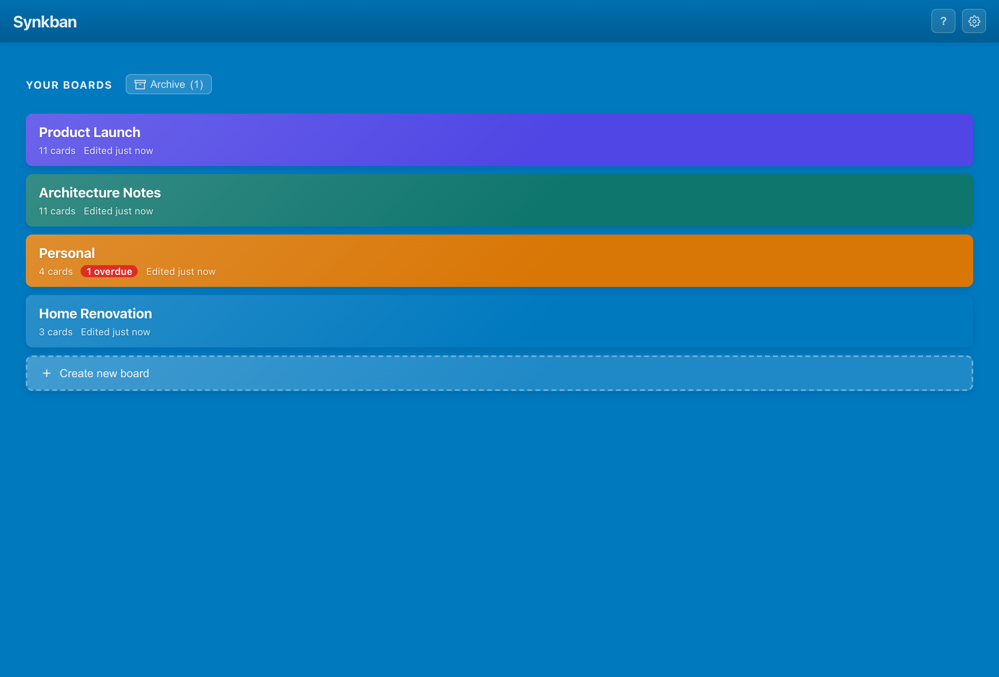

### Board Top Bar & Personalisation

Inside any board, the top bar gives quick access to board-wide controls:

- **Back to boards (`<` / `B`):** Return to the Board Overview.
- **View switcher (`Board` / `Notes` / `V`):** Toggle between **Kanban Mode** and **Notes Mode**.
- **Filter (`F`):** Show or hide the **Filter Bar**.
- **Inline board rename:** Click the board's title in the centre of the top bar, edit the name, and press `Enter` (or click away) to save, or `Esc` to cancel.
- **Archived cards (`A`):** Open the **Archive Panel** for this board.
- **Board colour (palette icon):** Open the colour picker and choose any custom colour with live preview across the board background, header, Home tiles, selection highlights, buttons, and focus rings (in both light and dark modes — header text and icons stay crisp white while very light header colours deepen just enough for legibility, Home tiles adapt ink automatically, and floating controls stay readable on any background), or click **Reset to default** to return to the classic blue (`#0079bf`).
- **Manage labels (`G`):** Toggle the right-side **Label Drawer**.
- **Keyboard shortcuts (`?`):** Open the contextual shortcut help dialog.
- **Settings (gear icon):** Open **Settings** from any page.

### Switching Boards & Session Memory

When you have two or more active boards, a **Board Dock** appears as a pill of coloured dots pinned at the bottom of the screen (scrollable horizontally when you have many boards):

- Click any dot to jump directly to that board (hover for the board title).
- Press **`,` or `J`** to switch to the previous board, and **`.` or `K`** to switch to the next board (wraps around in Board Overview order).

**Session view memory:** Within your open tab or desktop window, switching between boards remembers per board:

- Your **last focused card**
- Horizontal board scroll and **per-list vertical scroll** positions
- Whether the **Filter Bar** was open and its active text, due-date, and label filters
- Which card was last open in each list in **Notes Mode**

This orientation state lives for the current session only (closing the tab or desktop app resets it cleanly).

---

## Kanban Mode & Notes Mode

Every board remembers its own view mode (**Kanban Mode** or **Notes Mode**) so a board dedicated to writing notes opens in Notes Mode on all your synced devices. Toggle modes anytime with **`V`** or the **Board / Notes** switch in the top bar.

### Kanban Mode

**Kanban Mode** (the default) arranges your lists side by side:

- **At-a-glance card badges:** Cards display their formatted title, assigned **Labels** (in board order), **Due Date** badge, a description icon if the card has notes, **Checklist** progress (`done/total`, highlighted when all items are checked), and **Attachment** count.
- **Collapsed Lists:** Need more horizontal room while keeping a list nearby? Click the collapse chevron (`<`) in a list's header or press **`C`** while focus is inside that list. The list folds into a narrow vertical strip showing its card count and vertical title.
  - Collapsed lists stay fully interactive: drop cards onto the strip (or move focused cards onto it with `Shift + ← / →`) to append them to the bottom of that list.
  - Click the strip or press `Enter` / `C` on it to expand the list again.
  - Collapse state is saved per list and syncs across devices.
- **Sticky-row horizontal navigation:** Pressing `←` / `→` across lists remembers your vertical row index (like a cursor moving across lines of text). Passing through a shorter list, an empty list, or a **Collapsed List** keeps your target row so you land back at the same depth on the next taller list. Moving vertically (`↑` / `↓` / `Home` / `End`) or clicking resets the remembered row.

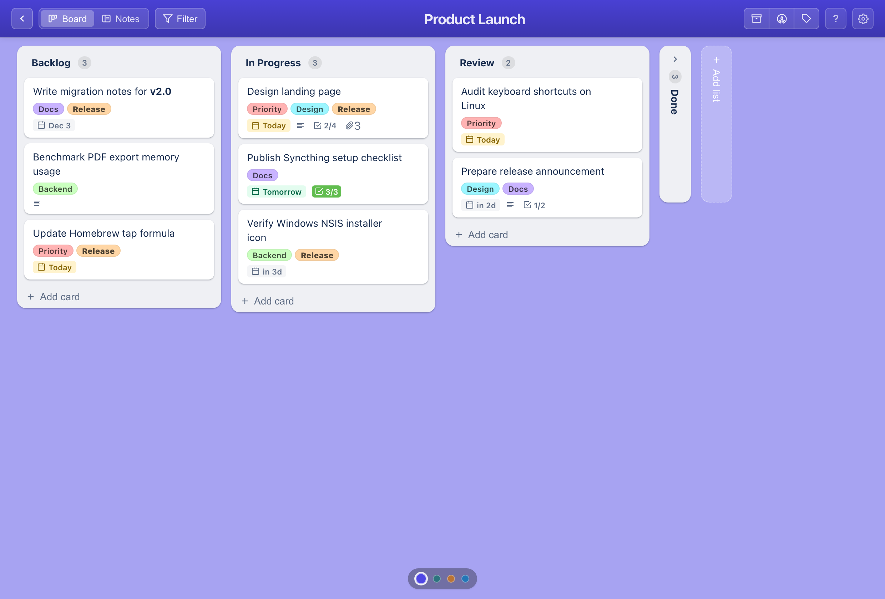

### Notes Mode

**Notes Mode** turns the board into a distraction-free master-detail workspace built for cards with long descriptions:

- **List Tabs across the top:** Every list appears as a tab showing its card count (`shown/total` while filtering). Click a tab or press **`←` / `→`** to switch lists.
- **Active tab as list header:** Click the active tab (or press **`R` / `F2`**) to rename the list, or click its **`×`** button to delete the list.
- **Move cards across tabs:** Drag any card onto another **List Tab** to append it to the bottom of that list, or press **`Shift + ← / →`** (or **`Shift + Alt + ← / →`** to reorder the tabs themselves).
- **Split master-detail workspace:** The active list sits on the left; the selected card opens inline on the right in the **Notes Pane** (with the description spanning the pane and centred at a comfortable 90-character reading measure). On narrow windows (under 760 px wide), the card list stacks neatly above the Notes Pane.
- **Keyboard flow:**
  - Press `↑` / `↓` to browse cards (when clean, moving focus displays each card immediately; when you have unsaved edits, focus moves without discarding your edits until you choose a card with `Enter` or click).
  - Press **`Enter` or `E`** to jump straight into editing the card's description.
  - Press **`Esc`** from anywhere outside the card (or inside the Notes Pane) to return focus to the selected card in the list — going through the unsaved-changes guard if needed.
- **Save & stay:** Pressing **`Cmd/Ctrl + S`** or clicking **Save** saves in place and displays `"Saved HH:MM"` in the footer without closing the card. A **Revert** button lets you roll unsaved edits back to the saved card.
- **Unsaved changes indicator:** A dot appears both on the card icon in the pane and on the active **List Tab** whenever the open card has unsaved edits.
- **External conflict protection:** If another device syncs a change to the currently open card while you have unsaved edits in the Notes Pane, Synkban keeps your edits safe and displays a banner offering **Load theirs** (or **Save** to keep your version — their version remains accessible in Card History). If the card was archived or deleted elsewhere while dirty, a banner lets you **Restore & save** it back into the active list.

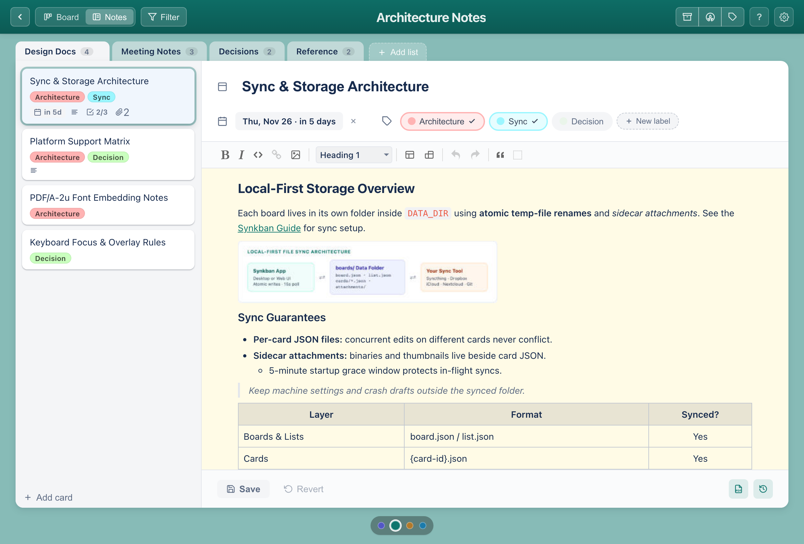

---

## Lists & Cards

### Working with Lists

- **Add a list:** Click **Add list** (shown as a compact vertical strip in Kanban Mode, or inline beside the tabs in Notes Mode) or press **`L`**, type a name, and press `Enter`.
- **Rename a list:** Click the list title (or active **List Tab** in Notes Mode), or focus the list and press **`R`** or **`F2`**. Press `Enter` to save or `Esc` to cancel.
- **Reorder lists:** Drag a list by its header to drop it in a new position, or press **`Shift + Alt + ← / →`** while focused on a card or the list's *Add card* button.
- **Collapse / expand a list (Kanban Mode):** Click the collapse chevron or press **`C`**.
- **Delete a list:** Click the `×` button in the list header (or active List Tab). If the list contains cards, Synkban asks for confirmation; deleting the list moves all of its cards safely to **Archived Cards** as **Orphaned Cards**.

### Adding Cards & Quick-Add Syntax

Click **Add card** in any list or press **`N`** (targets the currently focused list, or the first uncollapsed list if none is focused). Press `Enter` to create the card and stay ready to type another, or `Esc` to close the form (your open form draft is preserved across background refreshes).

You can assign **Labels** and a **Due Date** right inside the new card's title using **Quick-add** tokens:

```text
Send tax documents #finance #urgent due:fri
```

- **`#label`:** Adds an existing board label or automatically creates a new one on creation.
  - Matching ignores case, spaces, and dashes: `#in-progress`, `#InProgress`, and `#in progress` all match a label named `In Progress`.
  - `#` must start a word and be followed by a letter — numbers like `#42` or `#2026` stay untouched as literal title text.
- **`due:…`:** Accepts any date expression the **Due Date Picker** understands (`due:2026-12-01`, `due:today`, `due:tomorrow`, `due:fri`, `due:+3d`, `due:+2w`, `due:-1d`). Tokens that cannot be parsed (like `due:someday`) remain literal text in the title.
- **Live preview:** Below the input field, Synkban previews the labels to be applied (existing labels shown solid, new labels to be created shown with a dashed border) and the resolved due date before you press `Enter`.
- **Title required:** A card consisting only of tokens cannot be submitted until you include title text.

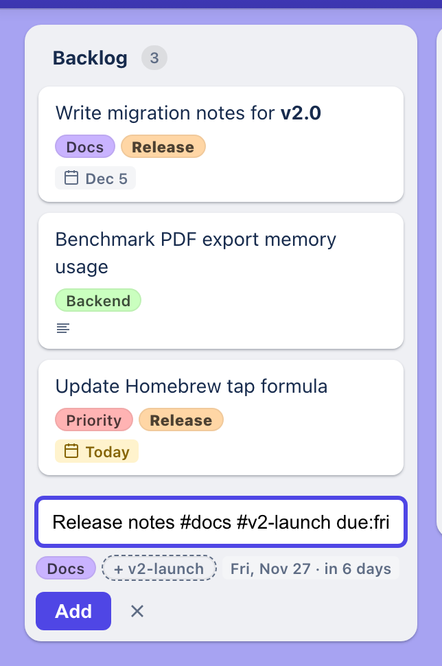

### Title Formatting

Both **Card** titles and **Label** names support lightweight inline Markdown formatting:

- Wrap text in `**bold**` or `*italic*`, or select text inside the title/label input and press **`Cmd/Ctrl + B`** or **`Cmd/Ctrl + I`**.

### Moving & Reordering (Mouse, Keyboard & Touch)

Synkban supports three seamless ways to reorder boards, lists, cards, labels, and checklist items:

- **Mouse drag-and-drop:** Drag cards within a list or across lists (including onto **Collapsed Lists** in Kanban Mode or **List Tabs** in Notes Mode), drag lists horizontally, drag boards on the Overview, drag labels in the **Label Drawer**, and drag checklist items inside a card.
- **Keyboard:**
  - `Shift + ↑ / ↓`: Move card up/down (wraps around in Kanban Mode) or reorder labels / checklist items.
  - `Shift + Home / End` (`Shift + PgUp / PgDn`): Move card to the top or bottom of its list.
  - `Shift + ← / →`: Move card to the previous or next list (or List Tab in Notes Mode).
  - `Shift + Alt + ← / →`: Reorder the current list left or right.
- **Touch screens (phones & tablets):** **Long-press** (~220 ms without moving your finger) on any draggable board, list, card, label, or checklist item until it picks up, then drag to the target position (edges auto-scroll near screen borders) and release. Quick taps and normal scrolling continue to work as expected.

---

## Working Inside a Card

Click any card (or focus it and press **`Enter`** or **`Space`** / **`E`**) to open it in the **Card Modal** (in Kanban Mode) or focus the **Notes Pane** (in Notes Mode).

Every section inside a card has a keyboard shortcut to jump directly to it:

- **`Cmd/Ctrl + E`**: Title (`Enter` moves focus down into the Description)
- **`Cmd/Ctrl + U`**: Due Date picker
- **`Cmd/Ctrl + G`**: Labels row
- **`Cmd/Ctrl + D`**: Description editor
- **`Cmd/Ctrl + L`**: Checklist (expands it if empty and focuses the add-item field)
- **`Cmd/Ctrl + O`**: Add Attachment (opens file chooser)
- **`Cmd/Ctrl + J`**: Card History
- **`Cmd/Ctrl + P`**: Export PDF

### Deliberate Saves & Unsaved Changes Guard

A card's **title, labels, due date, description, and checklist** are edited locally and saved together as one atomic update when you click **Save** or press **`Cmd/Ctrl + S`**. (Note: **Attachments** are separate files and persist immediately upon upload or deletion.)

- When edits are unsaved, a dot appears on the card icon at the top left and the footer displays **Unsaved changes**.
- Attempting to close the **Card Modal** (`Esc`, `×`, or clicking outside) or leave a dirty card in the **Notes Pane** opens a confirmation dialog with **Save** (default), **Discard**, and **Cancel** (`Esc`).
- Clearing the card title and trying to save shows an inline error banner reminding you that a card title cannot be empty and returns focus to the title field.

### Rich-Text Description Editor

The description area (styled with a subtle warm note background) gives you structured rich text stored cleanly without raw HTML:

- **Toolbar controls:** Bold, Italic, Inline code, **Highlight** (8-color semantic palette), Add or edit link, **Text style** dropdown (showing the active style), **Insert** dropdown (icon + text: **Footnote**, **Image**, **Table**, **Matrix**, **Bullet list**, **Ordered list**, **Blockquote**, **Alert**), Undo, Redo, and **Find in description** (`Cmd/Ctrl + F`).
- **Text Styles:** **Plain text**, **Code block**, **Heading 1**, **Heading 2**, **Heading 3** (selectable via the toolbar dropdown, `Ctrl + Shift + 0 / 1 / 2 / 3 / \`, or the Editor Menu).
- **Markdown typing shortcuts (start of a line):**
  - `# `, `## `, `### ` → Heading 1, 2, 3
  - `- ` or `* ` → Bulleted list
  - `1. ` → Numbered list
  - `> ` → Quote
  - ```` ``` ```` → Code block
  - Press `Backspace` immediately after any auto-conversion to undo it back to plain characters.
- **Lists & nested lists:** Inside a list, press **`Tab`** / **`Shift + Tab`** (or **`Cmd/Ctrl + ]`** / **`Cmd/Ctrl + [`**) to indent or outdent items; press `Enter` on an empty item to exit the list. Outside lists and tables, `Tab` moves focus to the next control as usual. To convert an existing bullet list to a numbered list (or vice versa), open the Editor Menu (**`Cmd/Ctrl + K`** or right-click) and press **`C`**, choose the other list type from **Insert**, or press **`Ctrl + Shift + 8`** / **`Ctrl + Shift + 9`**. Conversion applies to the whole innermost enclosing list (leaving nested sublists and adjacent lists untouched) and is undoable in one step.
- **Smart links:**
  - Typing a URL followed by whitespace (`https://…` or `www.…`) automatically creates a clickable link (trailing punctuation stays outside the link).
  - Pasting a URL while text is selected wraps that text as a link; pasting a bare URL inserts it linked.
  - Allowed link schemes: `http:`, `https:`, and `mailto:` (`www.` automatically becomes `https://`). Unsafe schemes are rejected.
  - Plain click opens the link (new tab in Web Mode, default browser in Desktop Mode). **`Cmd/Ctrl + Click`** edits or removes the link (editing always targets the whole link cleanly rather than splitting it).
- **Context-sensitive Editor Menu (`Cmd/Ctrl + K` or Right-Click):**
  - Opens right beside your caret (or pointer) without losing your text selection or touch keyboard.
  - Use **`↑` / `↓` / `Home` / `End` + `Enter`** or press the single-letter/digit shortcut shown next to each item (`L` link, `U` remove link, `I` inline code, `H` toggle highlight, `G` highlight color, `M` insert image, `F` insert or jump footnote, `0` plain, `B` code block, `E` Lua block, `1`–`3` headings, `T` table, `X` matrix, `A` insert/change alert, `C` convert bullet/ordered list when inside a list, plus table actions when inside a table).
- **Text highlights:**
  - Highlight text in any of 8 theme-aware colors (**Yellow**, **Orange**, **Red**, **Pink**, **Purple**, **Blue**, **Green**, **Gray**).
  - **Toolbar split button:** click the left half to highlight in the **last used color** (default Yellow) — or to remove the highlight when highlighted text is selected or the cursor is inside a highlighted span. Click the right chevron to open a compact color-swatch popover (swatches + clear button, no labels or shortcuts).
  - **Keyboard (`Cmd/Ctrl + K`):** press **`H`** to run the same default toggle (apply last color / remove highlight), or **`G`** to open the full color picker (`1`–`8` pick a color, `0` clears). Highlights work in paragraphs, headings, lists, alerts, footnotes, and table cells, never shift text layout, and export as pastel backgrounds in PDFs.
- **Alerts:**
  - Add semantic callout blocks (**Note**, **Tip**, **Important**, **Warning**, **Caution**) via **Insert → Alert** or the Editor Menu (`Cmd/Ctrl + K`, then `A`). Press `N`, `T`, `I`, `W`, or `C` to insert or switch an alert's kind (or click the alert's header badge), and `X` inside an alert to remove the alert wrapper while keeping its content. Press `Shift + P` / `P` in the Editor Menu to insert a paragraph above or below an alert.
- **Footnotes:**
  - Insert numbered footnotes from **Insert → Footnote** or via the Editor Menu (`Cmd/Ctrl + K`, then `F`). Footnote definitions always remain pinned at the bottom of the description, automatically numbered and sorted (`[1]`, `[2]`, …) by order of first reference in the text.
  - Press **`Cmd/Ctrl + Enter`** when the cursor is next to or selecting a reference (`[1]`) to jump down to its definition, and press **`Cmd/Ctrl + Enter`** again (or activate the marker / `↩` button via click or keyboard) inside a definition to jump right back to the reference you came from.
  - Inside a footnote definition, open the Editor Menu (`Cmd/Ctrl + K`) and press **`D`** (*Delete footnote*) — or activate the `×` button via click or keyboard — to remove the footnote and its references in one undoable step.
  - Deleting the last reference to an empty footnote removes it automatically; deleting the last reference to a non-empty footnote keeps the definition dimmed at the bottom as `[—]` so prose is not lost (click `×` to delete it). Orphaned definitions are omitted from exported PDFs.
  - In exported PDFs, footnotes appear at the bottom of every page that references them (below a short rule), with numbering restarting at `[1]` on each page.
- **Find & Replace (`Cmd/Ctrl + F` / `Cmd/Ctrl + Shift + H`):**
  - Press **`Cmd/Ctrl + F`** (or click the magnifying-glass button in the toolbar) to open a compact search bar docked beneath the toolbar. If a single-line phrase is selected in the description, it pre-fills the search box automatically.
  - Toggle **`Aa`** for case-sensitive matching and **`.*`** for regular expressions (invalid regex patterns show an inline error message).
  - Press **`Enter`** / **`Shift + Enter`** (or click `↓` / `↑`) to step through highlighted matches across paragraphs, inline formatting, tables, and Lua blocks.
  - Click the disclosure chevron (`▸`) or press **`Cmd/Ctrl + Shift + H`** to expand **Replace**: press **`Enter`** to replace the active match and advance, or **`Cmd/Ctrl + Enter`** (**Replace all**) to replace every match in one undoable step (`Cmd/Ctrl + Z`). In regex mode, replacement strings support capture groups (`$1`, `$&`, `$$`); in plain mode, `$` is inserted literally.
  - Press **`Esc`** to close the search bar and return focus to the active match without closing the card. Switching to another card in Notes Mode closes the search bar automatically.

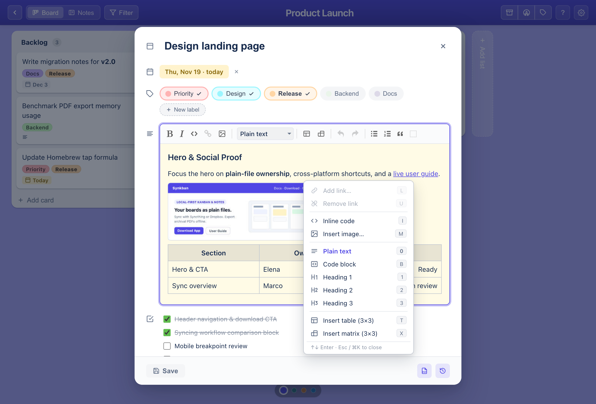

### Tables & Matrices

Insert structured data directly in any card description using **Insert → Table** / **Insert → Matrix** in the toolbar or **`Cmd/Ctrl + K`** (`T` for a 3×3 table, `X` for a 3×3 matrix).

- **Tables:**
  - The first row is always the centred **Header Row** (cannot be deleted past being replaced or moved down).
  - Column alignment (**Left**, **Centre**, **Right**) is controlled per column and stays consistent automatically as you add or move rows.
- **Matrices:**
  - Designed for comparison grids and 2D tables: the top-left corner cell is intentionally empty and uneditable, while **both the first row and the first column** act as centred headers.
  - Body cells support **per-cell alignment**.
  - **Transpose (`X` in the Editor Menu):** Swaps rows and columns (headers and cell alignments included) in a single undoable step.
- **Keyboard navigation & editing inside tables/matrices:**
  - `Tab` / `Shift + Tab`: Move to next / previous cell (`Tab` from the very last cell appends a new row automatically; `Shift + Tab` skips the locked top-left corner of a matrix).
  - `Enter`: Move to the same column in the next row (exits the table from the last row).
  - `Shift + Enter`: Insert a line break inside the current cell.
  - **Editor Menu (`Cmd/Ctrl + K` or Right-Click inside a cell):**
    - `W` / `S` / `A` / `D`: Move current row up/down or column left/right
    - `X`: Transpose matrix (matrices only)
    - `Shift + ↑ / ↓ / ← / →`: Insert row above/below or column left/right
    - `1` / `2` / `3`: Align column (or body cell in a matrix) Left / Centre / Right
    - `R` / `C` / `T`: Delete row / delete column / delete table or matrix

In the **Card Modal**, tables span the full editor width; in **Notes Mode**, tables and code blocks grow cleanly to fit their content (scrolling horizontally inside the description if wider than the pane).

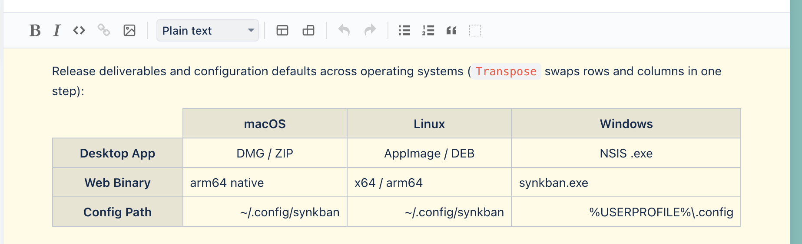

### Lua Blocks (Calculations & Scratchpads)

Synkban lets you embed runnable **Lua 5.4** blocks directly inside a card or note description. **Lua blocks are intentionally designed for short calculations, quick scratchpads, and inline note helpers** — estimating totals, formatting numbers, checking formulas, or verifying small bits of logic right beside your notes — rather than acting as a full code IDE or running external I/O. Because output is saved inside the card itself, exported PDFs, offline reading, and mobile/desktop syncing always preserve your last computed result without needing to re-run code automatically.

- **Insert or convert:** Type ```` ```lua ```` at the start of a line (converts immediately and consumes an optional `Space` or `Enter`), or open the Editor Menu (`Cmd/Ctrl + K`) and press **`E`** (Lua block) to insert a block or switch the current block to Lua. Pressing `Shift + Enter` inside the block exits into a normal paragraph below; pressing `Backspace` inside an empty block turns it back into plain text.
- **Syntax highlighting & autocomplete:** Native editor styling highlights keywords, strings, numbers, comments, and functions. As you type identifiers (at least two characters) outside strings and comments, a completion popup suggests matching local variables, Lua keywords, built-in globals, and standard library functions (`math.*`, `string.*`, `table.*`, `os.*`). Press **`Tab`** to accept the top suggestion, navigate with **`↑` / `↓`** and press **`Enter`** to accept a selected item (`Enter` without arrow selection inserts a newline as usual), or dismiss with **`Esc`** (dismissing the popup keeps the card open).
- **Run & persist output:** Press **`Cmd/Ctrl + Enter`** inside a Lua block or click **Run** to execute the snippet manually — Lua blocks **never run automatically** when opening a card. Both `print(...)` lines and any returned value (`return ...`) appear in the output tray (`=> ...`), alongside **`Ran`** when up to date or **`Outdated`** if you have edited the code since the last run. Click **Clear** to discard saved output.
- **Sandboxed execution:** Code runs locally and offline inside a dedicated Lua 5.4 WebAssembly Web Worker with dangerous globals (`io`, `package`, `require`, `debug`, `dofile`, `loadfile`, process control) removed, read-only `os.time` / `os.date` / `os.clock` / `os.difftime`, a 16 MB memory limit, and a **1.5 s timeout** so infinite loops cannot freeze the app.

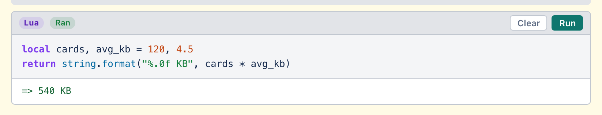

### Inline Images

Image attachments can be placed directly inside a card's description as **Inline Images**:

- **Three ways to insert:**
  1. **Paste directly from clipboard** (e.g. a screenshot): pasting an image while your cursor is inside the description uploads it and inserts it at the caret immediately. (Pasting an image anywhere else inside the open card uploads it to the Attachments grid without inserting it into the text.)
  2. **Image Picker (`Cmd/Ctrl + K` then `M`, or toolbar image icon):** Pick any image already attached to the card (press `1`–`9` or `↑` / `↓` + `Enter`) or press **`U`** to upload a new image and insert it.
  3. **From the Attachments grid:** Hover or focus an image tile and click its **`+`** (*Insert into description*) button.
- **Lightbox preview:** Click any inline image to open a full-size preview overlay (`Esc` closes the preview).
- **Copy & paste between cards:** Copying rich text that contains inline images from one card and pasting it into another card automatically duplicates those image attachments onto the destination card so references stay valid everywhere.
- **Automatic cleanup:** Attachments displayed inline show an **`in text`** badge in the Attachments grid. Deleting a referenced attachment asks for confirmation first and automatically strips its inline references from the description.

### Labels & Label Drawer

Labels are colour-coded per board — automatically assigned from a distinct 12-colour pastel palette and customisable at any time.

- **Manage Labels (`G`):** Opens the right-side **Label Drawer** where you can:
  - Create new labels (names support `**bold**`/`*italic*` via `Cmd/Ctrl + B` / `Cmd/Ctrl + I`).
  - **Change label colour:** Click any label's colour swatch to pick from the 12 pastel presets or choose any custom colour with the colour picker (`Esc` closes the picker without closing the drawer). Label chips on cards, quick-add previews, and exported PDFs automatically switch between dark and white text for high contrast.
  - Rename labels (`Enter` on a focused row or click to edit) and delete labels.
  - **Reorder labels:** Drag rows or focus a row and press **`Shift + ↑ / ↓`**. The order in the Label Drawer controls the display order of labels everywhere — on cards, inside the Card Modal, and in the Filter Bar.
- **Smart duplicate prevention & Label Merge:**
  - Label names match loosely (ignoring case, spaces, and dashes). Creating `bug` when `Bug` already exists selects the existing label rather than creating a duplicate.
  - Renaming an existing label onto another label's name triggers a **Label Merge** confirmation dialog (irreversible): the target label survives and every card on the board (including archived cards) carrying the merged label is updated automatically.
- **Assign inside a card (`Cmd/Ctrl + G`):**
  - Assigned labels appear first with a checkmark (`✓`), followed by unassigned labels (if your board has many labels, click **+N more** to expand the rest). While hovering or navigating the row with the keyboard, chip positions stay frozen so chips never jump out from under your pointer.
  - Click the dashed **New label** chip to create and immediately assign a new label without leaving the card.

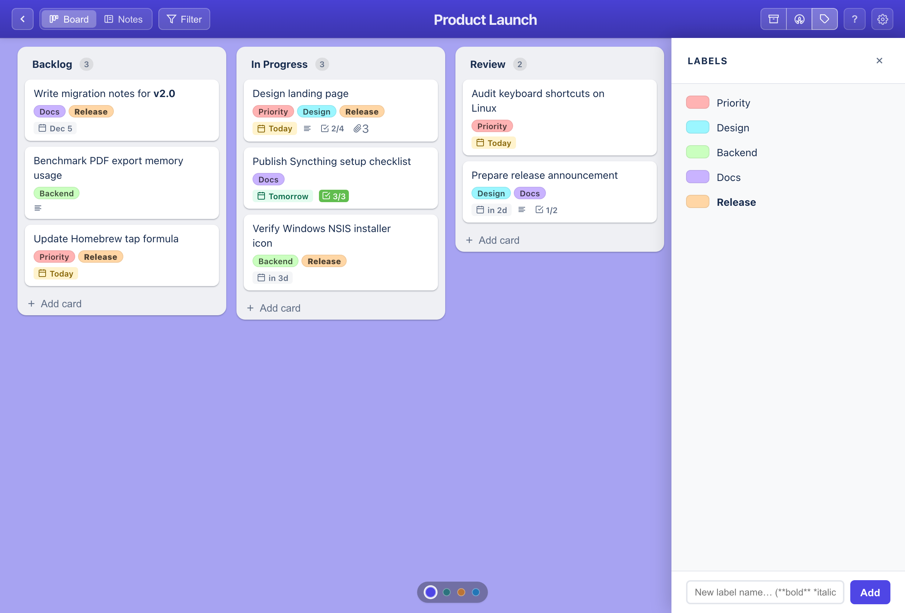

### Due Dates & Keyboard-First Picker

Click the **Due Date** chip (`Set due date` when empty) or press **`Cmd/Ctrl + U`** to open the popover picker.

**Consistent human-readable wording:**
- Within 7 days, dates display relatively (`Today`, `Tomorrow`, `in 3d`, `Overdue 3d`).
- Beyond a week, the calendar date takes over (`Nov 28`, `Overdue · Nov 2`; the year appears only when different from the current year) so you never have to do mental calendar math.
- Badges and chips are colour-coded by urgency (overdue, today, soon, future).

**Three fast ways to pick a date:**
1. **Type directly** (focused automatically when opened) and press **`Enter`**:
   - Exact ISO date: `2026-12-01`
   - Words (3+ letters): `today`, `tomorrow` (or `tod`, `tom`)
   - Weekday (3+ letters): `mon`, `tue`, `wed`, `thu`, `fri`, `sat`, `sun` (picks the next occurrence after today)
   - Relative offset: `+3`, `+3d`, `+2w`, `-1d`
   - Leave empty and press `Enter` to clear the due date.
2. **Navigate the calendar grid** (press **`↓`** from the text field):
   - `←` `→` `↑` `↓`: Move by day or week
   - `PgUp` / `PgDn`: Previous / next month (`Shift + PgUp / PgDn` for year)
   - `Home` / `End`: Start / end of the week (respecting your locale's first day of the week)
   - `Enter` / `Space`: Pick the highlighted date
3. **Quick buttons:** Click **Today**, **Tomorrow**, **Next week**, or **Clear** (or click the `×` right on the due-date chip).

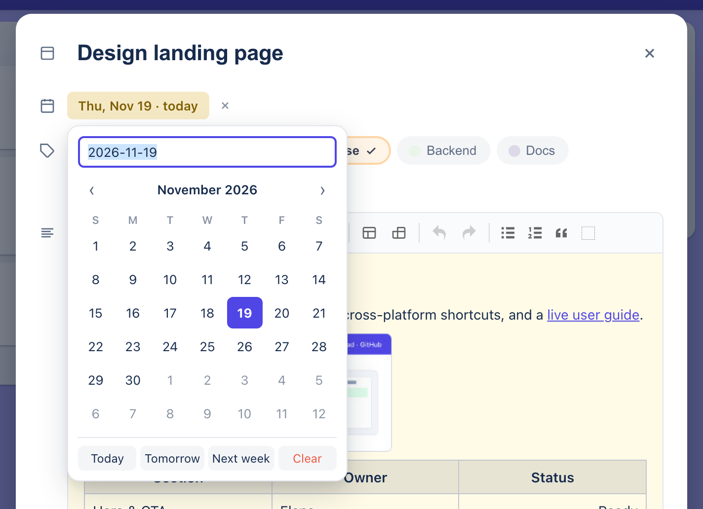

### Checklist

Cards can include a flat **Checklist** (`Cmd/Ctrl + L` expands it if hidden and focuses the *Add checklist item…* field; if you leave an empty checklist without typing anything, it quietly collapses again).

- **Add items:** Type an item and press `Enter` — focus stays in the input so you can add multiple items rapidly.
- **Keyboard navigation & actions on checklist items:**
  - `↑` / `↓`: Move focus between items
  - `Space`: Toggle checked / unchecked
  - `Enter`: Edit item text inline (`Enter` saves, `Esc` cancels)
  - `Shift + ↑ / ↓` (or mouse/touch drag): Reorder items
  - `Del` / `Backspace`: Remove item (asks inline `Delete? Yes / No`, with `Esc` cancelling back to the item)
- **Check all / Uncheck all** button and live `done/total` progress pill appear beside the input once items exist.
- Checklist changes save atomically with the card (`Cmd/Ctrl + S`).

### Attachments

Each card can hold file attachments up to **50 MB** per file.

- **How to attach files:**
  - Click **Attachment** (or **Add** tile) or press **`Cmd/Ctrl + O`**
  - Drag and drop one or more files anywhere onto the open **Card Modal** or **Notes Pane**
  - Paste an image from the clipboard
- **Images vs. general files:**
  - Image attachments automatically generate a JPEG thumbnail (up to 400 px), show an **`in text`** badge when embedded in the description, and open in a full-size **lightbox preview** on click or `Enter`.
  - Non-image files display their file extension badge (`PDF`, `ZIP`, `TXT`, etc.) and download when clicked or activated with `Enter`.
- **Hover / focus actions:** Insert image into description (`+`, for images) or delete (`×`, or `Del` / `Backspace` on a focused tile).
- Attachments save and delete immediately as standalone sidecar files and record their filename in the card's **History**.

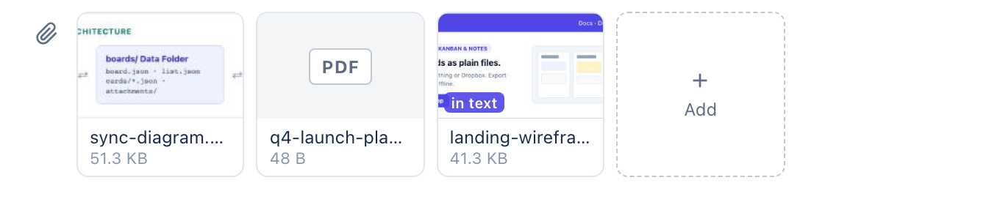

### Card History & Diffs

Press **`Cmd/Ctrl + J`** (or click the clock/history button in the card footer) to inspect the card's version **History**:

- Automatically records up to the **last 100 saved content versions** of the card (title, labels, due date, description, checklist, and attachment filenames). Moving a card between lists, reordering it, or archiving it does not clutter history with no-op entries.
- Select versions on the left (newest at the top; navigate with `↑` / `↓`, `PgUp` / `PgDn` by 10, `Home` / `End`) to view a **field-by-field diff** on the right showing exactly what was added (`+`) or removed (`−`) in that version — including row-by-row diffs for tables, fenced `lua` blocks with saved output/error lines, and `[image: filename]` markers for inline images.
- History is read-only. Press `Cmd/Ctrl + J` or `Esc` to close.

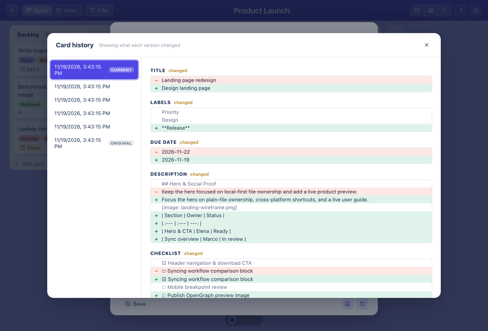

### Archival PDF/A Export

Press **`Cmd/Ctrl + P`** (or click the **PDF** button in the card footer) to download a self-contained **PDF/A-2u** archive of the card, named automatically from the card's title.

- **What gets included:** Formatted title, board name and card creation timestamp (UTC), label chips, due date, full rich-text description (headings, formatted and highlighted text, clickable links, nested lists, quotes, semantic alerts, code blocks, Lua blocks with their saved output/errors, tables & matrices with repeating headers, inline images, and same-page footnotes with per-page numbering), checklist (`☑` / `☐`), and remaining attachments (with thumbnails for non-inline images).
- **Clean pagination:** Sections, blocks up to half a page, and checklist/attachment groups are kept together where they fit, and paragraphs/tables split without leaving orphaned single lines or stranded table headers.
- **Unsaved edits prompt:** PDFs always render the *saved* card on disk. If you have unsaved changes when exporting, Synkban asks whether to **Save & export**, **Export saved version**, or **Cancel**.
- **Self-contained offline fonts:** Bundles DejaVu Sans, DejaVu Sans Mono, monochrome Noto Emoji, and Noto Sans Arabic, Hebrew, Devanagari, and Thai directly inside the app — zero reliance on system fonts or external browsers. *(To keep the app lightweight, CJK fonts are not bundled and appear as `?` in exported PDFs, though they display normally in the app.)*
- See **[PDF Export Examples](export-examples/README.md)** for visual reference sheets of every supported element and edge case.

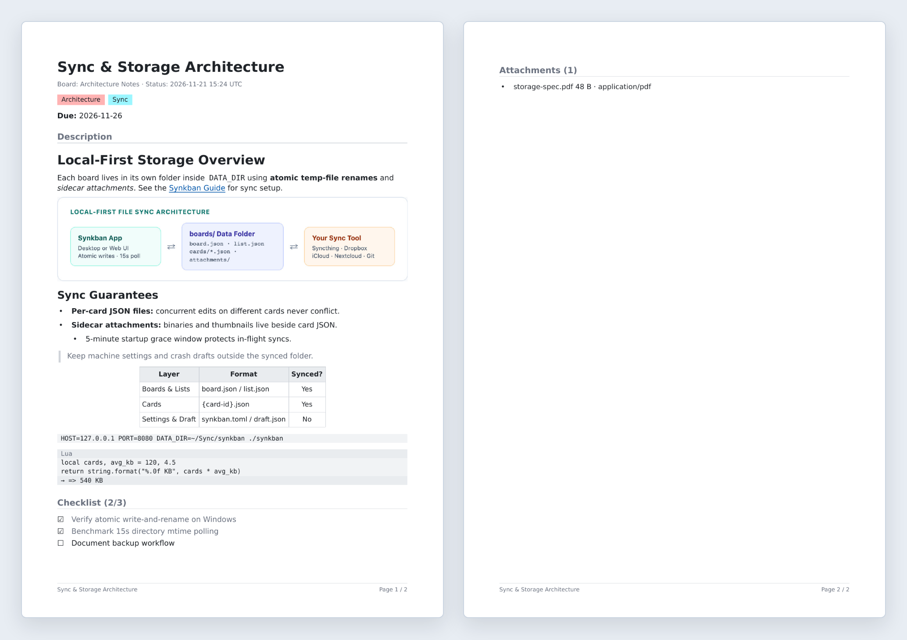

---

## Filtering Cards

Press **`F`** (or click **Filter** in the top bar) to toggle the **Filter Bar** below the header.

All three filter controls combine with **AND** logic (every active condition must match):

1. **Text filter:** Case-insensitive substring search across card **titles**, **descriptions** (including table cell text), and **checklist items**.
2. **Due-date filter** (pick one; click again to clear):
   - **Overdue:** Cards due before today
   - **This week:** Cards due within the current calendar week (according to your browser locale)
   - **Until…:** Opens the **Due Date Picker** and shows cards due on or before the chosen day (including overdue)
   - *(Cards with no due date never match while a due-date filter is active.)*
3. **Label filter:** Click one or more label chips to require cards to carry **all** selected labels.

While filtering, list headers (and **List Tabs** in Notes Mode) display counts as **`matching/total`**. Press **`Esc`** inside the filter field once to clear active filters, and **`Esc`** again to close the bar.

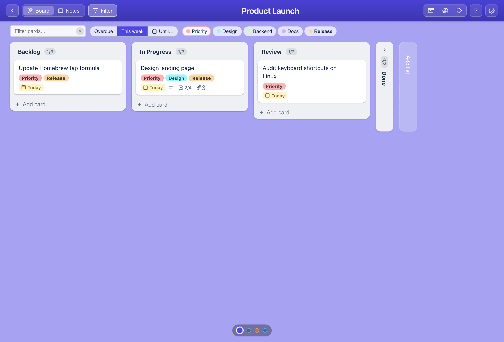

---

## Archiving & Permanent Deletion

To protect against accidental data loss (especially across synced devices), Synkban uses a two-step lifecycle for boards and cards:

1. **Archive first:** Archiving hides a board or card from normal views while keeping its JSON files and attachments intact on disk.
2. **Restore or Delete permanently:** Open **Archived Boards** (`A` on the Board Overview) or **Archived Cards** (`A` inside a board) to browse archived items (newest archived first; navigate with `↑` / `↓`).
   - Click **Restore** to bring the item back immediately.
   - Click **Delete** → **Delete permanently? Yes / No** to erase the item (and all of its attachments) permanently from disk.

**Deleting a List & Orphaned Cards:**
- Lists cannot be archived directly. When you delete a list (confirmation required if non-empty), Synkban archives all cards inside it as **Orphaned Cards** before removing the list.
- Restoring a regular archived card returns it to its original list. Restoring an **Orphaned Card** from the **Archive Panel** places it into the first active list on the board (if the board currently has no lists, create a list first). In **Notes Mode**, clicking **Restore & save** on an open dirty card that was archived elsewhere restores it into the currently active list.

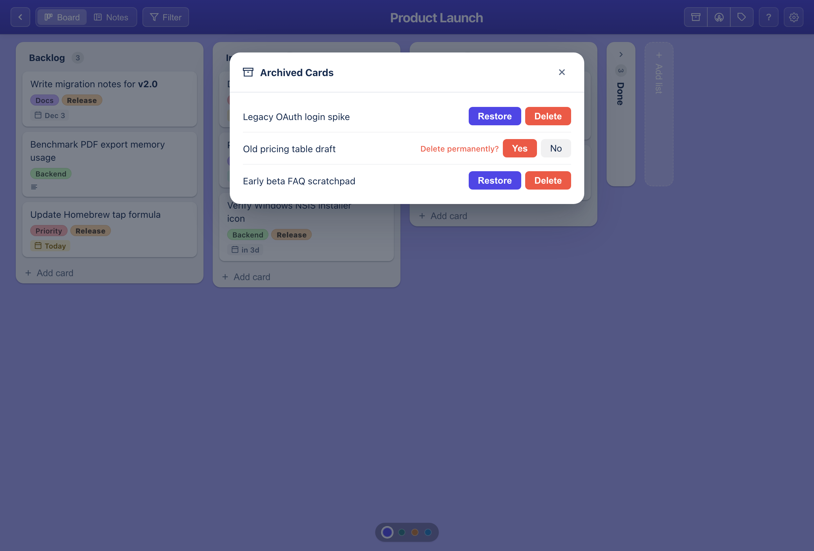

---

## Syncing, Backups & Crash Safety

### Syncing Across Devices

Because every board, list, card, and attachment lives as plain files inside your **Data Directory**, Synkban works seamlessly with folder-sync tools such as **Syncthing**, **Dropbox**, **iCloud Drive**, **Nextcloud**, **Git**, or **rsync**:

1. Set up a synced folder on each computer (for example `~/Sync/synkban`).
2. In the Desktop App, open **Settings → Data folder → Browse…**, select that synced folder, and click **Save & Restart**.
3. If you already created boards in the default folder, **copy the `boards/` folder** into your synced folder manually — changing the folder in Settings never moves existing files automatically.

**Sync tips:**
- **Sync only your Data Directory** — leave your machine's `~/.config/synkban/` folder unsynced so local settings and crash recovery stay per-computer.
- **Keep Synkban up to date on all devices** so newer card features (such as tables, matrices, Lua blocks, or inline images) render identically everywhere.
- **Automatic live updates:** Open boards check for external file changes every **15 seconds** and refresh automatically while keeping your cursor, open quick-add drafts, and card focus intact.

### Backups & Moving to a New Computer

- **Back up:** Copy your **Data Directory** (or its `boards/` folder). Because everything is plain files, standard backups (Time Machine, cloud backups, ZIP archives, or rsync) work cleanly without shutting Synkban down.
- **Move to a new computer:** Copy the folder to the new computer and point Synkban at it via **Settings → Data folder → Browse…**.

### Crash-Safe Drafts

Only one card can be open for editing at a time (in the **Card Modal** or **Notes Pane**). While it has unsaved changes:

- Synkban automatically keeps a local crash-recovery **Draft** on your machine as you type and when closing the window.
- If the app crashes, closes unexpectedly, or reloads before you save, launching Synkban automatically reopens that board and card with your edits and displays a **`Restored your unsaved edits … Discard`** banner.
- **Conflict safety:** If the card was updated on disk from another device in the meantime (or deleted), Synkban safely discards the stale draft instead of overwriting newer changes.
- Saving, clicking **Discard**, clicking **Revert**, or undoing back to the saved text clears the draft right away.

### Warnings & Offline Protection

- **Data-integrity Warning Banner:** If Synkban encounters an unreadable or half-synced file while reading your boards, it skips only that file, leaves it untouched on disk so nothing is lost, and displays a dismissible banner naming the exact file path so you can finish syncing or inspect it.
- **Network resilience (when connected to a server):** Already-loaded boards and open card edits stay safely on screen if a server restarts or your connection drops, failed quick-adds keep your typed text, and changes recover automatically when connectivity returns.

---

## Settings & Appearance

Click the **Settings** gear button in the top-right corner of the header on any page to configure:

- **Appearance:**
  - **Use system setting** (default) — follows your operating system's light or dark appearance live.
  - **Light** — always use the light theme.
  - **Dark** — always use the dark theme (adapts board backgrounds, card surfaces, sticky-note editor tint, and accent colours automatically).
  - Selecting an option previews the theme immediately; clicking **Cancel** or pressing `Esc` reverts it.
- **On startup, open:**
  - **Board overview** (default) — always starts on *Your Boards*.
  - **Last used board** — reopens the last board you visited (deep links to a specific board URL always take precedence, and if the last board was archived or deleted, Synkban falls back cleanly to the Board Overview).
- **Data folder:**
  - In Desktop Mode, displays the active folder path with **Browse…**, **Use default**, and **Save & Restart** (restarts the app onto the chosen folder; existing boards stay in the old folder).

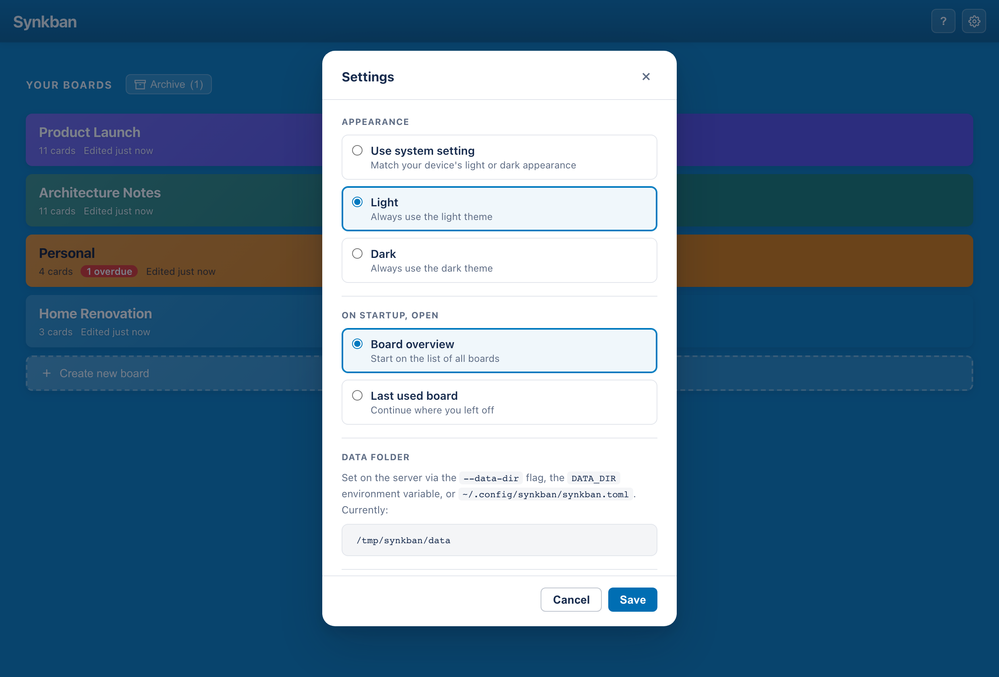

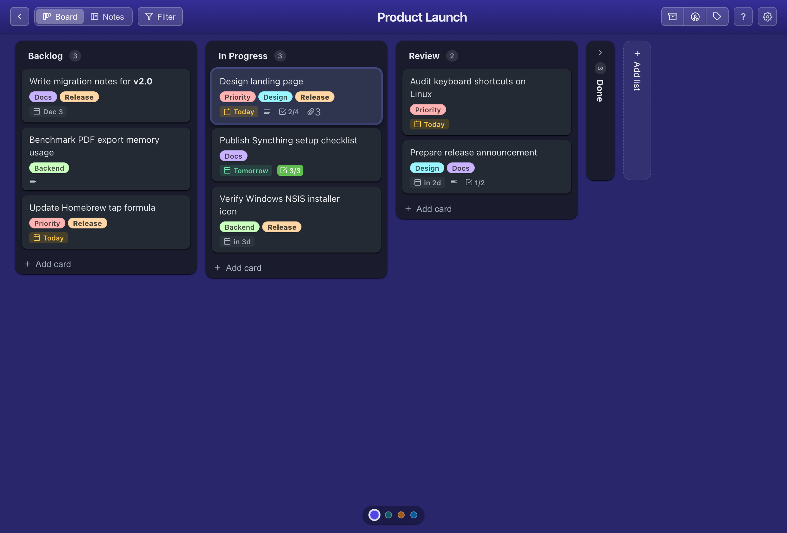

> Need to override the data folder via CLI flags, environment variables, or edit `synkban.toml` directly? See the **[Technical & Self-Hosting Reference](technical-reference.md)**.

---

## Keyboard Shortcuts

Press **`?`** at any time outside text fields (or click the **`?`** button in the top bar) to open the in-app **Keyboard shortcuts** dialog. It lists every available shortcut and opens directly to the tab matching where your cursor or focus currently is (**Boards**, **Board**, **Notes**, **Card**, or **Editor** — switch tabs with `←` / `→` or `1`–`5`, and close with `?` or `Esc`).

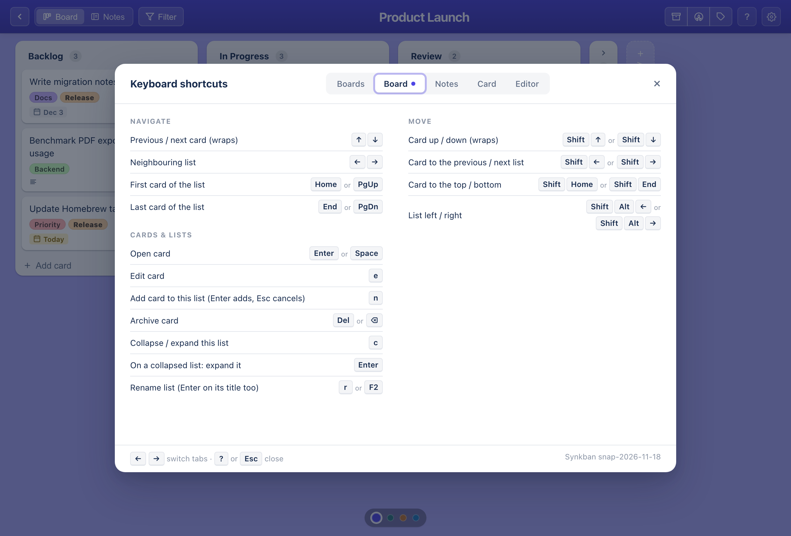

---

## Troubleshooting & FAQ

### macOS says `"Synkban.app" is damaged and can't be opened`
Release builds are currently unsigned. Installing via Homebrew (`brew install --cask waschmittel/synkban/synkban`) clears the quarantine flag automatically. For manual `.dmg`/`.zip` installs, clear it in Terminal and reopen the app:
```bash
sudo xattr -cr /Applications/Synkban.app
```

### I changed the Data folder in Settings and my existing boards disappeared
Changing the **Data folder** points Synkban at the new folder without moving files automatically. Copy your existing `boards/` folder from the old Data Directory (by default `~/.config/synkban/data/boards/` on macOS/Linux or `%USERPROFILE%\.config\synkban\data\boards\` on Windows) into the new folder and Synkban will pick them up on the next refresh or restart.

### Why does Synkban have a Save button on cards instead of autosaving every keystroke?
Syncing one JSON file per card across Dropbox, Syncthing, or Git works best when edits are written cleanly in one atomic step rather than mid-word every few milliseconds — and saving deliberately gives you meaningful **Card History** snapshots. Meanwhile, machine-local crash **Drafts** ensure you still never lose unsaved typing if the app closes or reloads unexpectedly.

### A yellow warning banner says a file could not be read and was skipped — is my data lost?
No. Synkban leaves skipped files untouched on disk so other boards and cards stay usable. This usually happens if a sync tool is mid-transfer or if a JSON file was edited manually with invalid syntax. Let your sync finish (or fix the syntax in the file path listed in the banner) and Synkban will pick it up on the next refresh.

### I accidentally deleted a list — are its cards gone?
No. Deleting a list automatically archives all cards that were inside it as **Orphaned Cards**. Press **`A`** on the board to open **Archived Cards** and click **Restore** to bring them back into the board's first list.

### How can I use Synkban on my phone or tablet?
Run Synkban in Docker behind an HTTPS reverse proxy (see the **[Technical & Self-Hosting Reference](technical-reference.md)** and [Traefik + Tinyauth PWA setup](docker/README.md)), sign in once, and install it to your Home Screen. Touch screens support scrolling, tapping, and **long-press drag-and-drop** for reordering cards, lists, boards, labels, and checklist items.

### Why do Chinese, Japanese, or Korean (CJK) characters appear as `?` in exported PDFs?
To keep the offline app and PDF export engine compact, CJK font files (10–18 MB each) are not bundled inside the app, and the PDF/A standard requires replacing missing glyphs with `?`. Inside the Synkban app itself, CJK text displays normally using your system fonts.

---

## Technical & Self-Hosting Reference

Looking for the standalone web server CLI flags, environment variables, Docker & PWA instructions, `synkban.toml` syntax, or the on-disk folder structure?

➡️ **[Technical & Self-Hosting Reference](technical-reference.md)**
